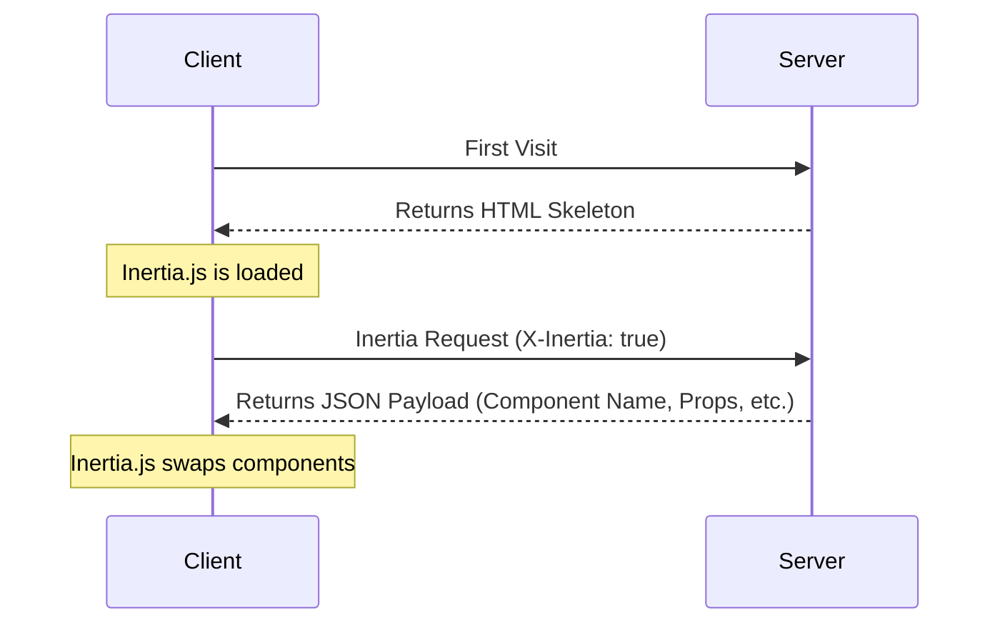

# The Protocol

This page contains a detailed specification of the Inertia protocol. Be sure to read the [how it works](/guide/how-it-works) page first for a high-level overview.

## HTML Responses

The very first request to an Inertia app is just a regular, full-page browser request, with no special Inertia headers or data. For these requests, the server returns a full HTML document.

This HTML response includes the site assets (CSS, JavaScript) as well as a root `<div>` in the page's body. The root `<div>` serves as a mounting point for the client-side app. A `<script type="application/json">` element contains the JSON encoded [page object](#the-page-object) for the initial page. Inertia uses this information to boot your client-side framework and display the initial page component.

Inertia Rails renders this `<script>` element when [`use_script_element_for_initial_page`](/guide/configuration#use-script-element-for-initial-page) is enabled. The installer enables it, and Inertia.js v3 reads the initial page only from the `<script>` element. With the option disabled, which is the gem default, the page object goes into a `data-page` attribute on the root `<div>` instead.

```http
REQUEST
GET: https://example.com/events/80
Accept: text/html, application/xhtml+xml

RESPONSE
HTTP/1.1 200 OK
Content-Type: text/html; charset=utf-8

<html>
    <head>
        <title>My app</title>
        <link href="/css/app.css" rel="stylesheet">
        <script src="/js/app.js" defer></script>
    </head>
    <body>
        <script data-page="app" type="application/json">{"component":"Event","props":{"errors":{},"event":{"id":80,"title":"Birthday party","start_date":"2019-06-02","description":"Come out and celebrate Jonathan's 36th birthday party!"}},"url":"/events/80","version":"c32b8e4965f418ad16eaebba1d4e960f"}</script>
        <div id="app"></div>
    </body>
</html>
```

While the initial response is HTML, Inertia does not server-side render the JavaScript page components. For information on server-side rendering, see the [SSR documentation](/guide/server-side-rendering).

## Inertia Responses

Once the Inertia app has been booted, all subsequent requests to the site are made via XHR with a `X-Inertia` header set to `true`. This header indicates that the request is being made by Inertia and isn't a standard full-page visit.

When the server detects the `X-Inertia` header, instead of responding with a full HTML document, it returns a JSON response with an encoded [page object](#the-page-object).

```http
REQUEST
GET: https://example.com/events/80
Accept: text/html, application/xhtml+xml
X-Requested-With: XMLHttpRequest
X-Inertia: true
X-Inertia-Version: 6b16b94d7c51cbe5b1fa42aac98241d5

RESPONSE
HTTP/1.1 200 OK
Content-Type: application/json
Vary: X-Inertia
X-Inertia: true

{
    "component": "Event",
    "props": {
        "errors": {},
        "event": {
            "id": 80,
            "title": "Birthday party",
            "start_date": "2019-06-02",
            "description": "Come out and celebrate Jonathan's 36th birthday party!"
        }
    },
    "url": "/events/80",
    "version": "6b16b94d7c51cbe5b1fa42aac98241d5",
    "encryptHistory": true
}
```

## Request Lifecycle Diagram

The diagram below illustrates the request lifecycle within an Inertia application. The initial visit generates a standard request to the server, which returns an HTML application skeleton containing a root element with hydrated data. For subsequent user interactions and navigation, Inertia sends XHR requests that return JSON data. Inertia uses this response to dynamically hydrate and swap the page component without a full page reload.



## How the Client Handles Responses

After each request, the client inspects the response before touching the page. Dispatch follows a small set of rules:

- **An Inertia response (`X-Inertia: true`)** is rendered directly: the client applies the page object and swaps the component.
- **A `409 Conflict` carrying `X-Inertia-Location`** triggers a full `window.location` visit to that URL, loading fresh assets. Background requests are exempt when the version changed, since reloading a visit the user never initiated would discard unsaved state.
- **A `409 Conflict` carrying `X-Inertia-Redirect`** triggers a fresh Inertia `GET` visit to that URL.
- **Any other response**, such as an HTML error page or plain JSON, is treated as an exception. The client fires a cancelable [HTTP exception event](/guide/events#http-exception) and, unless you cancel it, shows an error modal rather than silently navigating.

Standard `3xx` redirects never reach these rules. The browser follows them transparently, replaying the request headers against the new location, so `X-Inertia` reaches the redirect target and the client only ever inspects the final response in the chain. See [redirects](#redirects) for the statuses Inertia Rails returns to steer this.

A valid Inertia response with a status of `400` or greater fires that same cancelable HTTP exception event before rendering. Canceling it there suppresses the render, letting you handle the failure yourself.

## Request Headers

The following headers are automatically sent by Inertia when making requests. You don't need to set these manually, they're handled by the Inertia client-side adapter.

- `X-Inertia`: Set to `true` to indicate this is an Inertia request.
- `X-Requested-With`: Set to `XMLHttpRequest` on all Inertia requests.
- `Accept`: Set to `text/html, application/xhtml+xml` to indicate acceptable response types.
- `Content-Type`: Set to `application/json` for requests that do not include file uploads.
- `X-Inertia-Version`: The current asset version to check for asset mismatches.
- `X-XSRF-TOKEN`: The CSRF token read from the `XSRF-TOKEN` cookie, which Inertia Rails sets. See [CSRF protection](/guide/csrf-protection).
- `Purpose`: Set to `prefetch` when making [prefetch](/guide/prefetching) requests.
- `X-Inertia-Partial-Component`: The component name for [partial reloads](/guide/partial-reloads).
- `X-Inertia-Partial-Data`: Comma-separated list of props to include in partial reloads.
- `X-Inertia-Partial-Except`: Comma-separated list of props to exclude from partial reloads.
- `X-Inertia-Reset`: Comma-separated list of props to reset on navigation.
- `Cache-Control`: Set to `no-cache` for reload requests to prevent serving stale content.
- `X-Inertia-Error-Bag`: Specifies which error bag to use for [validation errors](/guide/validation). Note: This header is not used by the Rails adapter as error bags are a Laravel-specific feature.
- `X-Inertia-Infinite-Scroll-Merge-Intent`: Indicates whether the requested data should be appended or prepended when using [Infinite scroll](/guide/infinite-scroll).
- `X-Inertia-Except-Once-Props`: Comma-separated list of non-expired [once prop](/guide/once-props) keys already loaded on the client. The server will skip resolving these props unless explicitly requested via a partial reload or force refreshed server-side.

The following headers are used for [Precognition](/guide/forms#precognition) validation requests.

- `Precognition`: Set to `true` to indicate this is a Precognition validation request.
- `Precognition-Validate-Only`: Comma-separated list of field names to validate.

## Response Headers

Inertia Rails sets the following headers on Inertia page responses.

- `X-Inertia`: Set to `true` to indicate this is an Inertia response.
- `Vary`: Set to `X-Inertia` to help browsers correctly differentiate between HTML and JSON responses.

The following headers appear on `409 Conflict` responses instead. A `409` response carries no `X-Inertia` header, since it tells the client to navigate rather than render a page.

- `X-Inertia-Location`: The destination URL for a full `window.location` visit. Inertia Rails sets it for [external redirects](/guide/redirects#external-redirects): `inertia_location`, redirects marked with `inertia: { full_page: true }`, and cross-origin redirects. It also sets it on an [asset version](#asset-versioning) mismatch, where it holds the requested URL.
- `X-Inertia-Redirect`: The full redirect URL, including its fragment, for a redirect whose target contains a URL fragment. Triggers a fresh Inertia `GET` visit instead of a full page reload. Inertia Rails sends it only when [`convert_fragment_redirects`](/guide/configuration#convert-fragment-redirects) is enabled, as it is in apps set up with the installer.
- `X-Inertia-Version`: The current asset version, sent on an asset version mismatch `409` so the client can see it.

The following headers are used for [Precognition](/guide/forms#precognition) validation responses.

- `Precognition`: Set to `true` to indicate this is a Precognition validation response.
- `Precognition-Success`: Set to `true` when validation passes with no errors, combined with a `204 No Content` status code.
- `Vary`: Includes `Precognition` on responses from actions that call `precognition!` or `precognition`.

## The Page Object

Inertia shares data between the server and client via a page object. This object includes the necessary information required to render the page component, update the browser's history state, and track the site's asset version. The page object can include the following properties:

- `component`: The name of the JavaScript page component.
- `props`: The page props. Contains all of the page data along with an `errors` object. When there are no errors, `errors` is `{}` if [`always_include_errors_hash`](/guide/configuration#always-include-errors-hash) is enabled, as it is in apps set up with the installer. Otherwise, it's absent.
- `url`: The page URL.
- `version`: The current [asset version](/guide/asset-versioning).
- `encryptHistory`: Whether or not to [encrypt the current page's history state](/guide/history-encryption). Only included when `true`.
- `clearHistory`: Whether or not to clear any [encrypted history state](/guide/history-encryption#clearing-history). Only included when `true`.
- `preserveFragment`: Whether to [preserve the URL fragment](/guide/redirects#preserving-fragments) from the original request across a redirect.
- `preserveBigIntegers`: Whether `{"$bigint": "..."}` markers in `props` and `flash` should be turned into [`BigInt` values](/guide/big-integers). Only included when `true`.
- `mergeProps`: Array of prop keys that should be [merged](/guide/merging-props) (appended) during navigation.
- `prependProps`: Array of prop keys that should be [prepended](/guide/merging-props) during navigation.
- `deepMergeProps`: Array of prop keys that should be [deep merged](/guide/merging-props#deep-merge) during navigation.
- `matchPropsOn`: Array of prop keys to use for [matching when merging props](/guide/merging-props#matching-items).
- `scrollProps`: Configuration for [infinite scroll](/guide/infinite-scroll) prop merging behavior.
- `deferredProps`: Configuration for client-side [lazy loading of props](/guide/deferred-props).
- `rescuedProps`: Array of [deferred prop](/guide/deferred-props#error-handling) keys that failed to resolve and were rescued server-side. Used by the client to render the `rescue` slot on the `<Deferred>` component.
- `sharedProps`: Array of top-level prop keys registered via [`inertia_share`](/guide/shared-data). Used by the client to carry shared props over during [instant visits](/guide/instant-visits).
- `onceProps`: Configuration for [once props](/guide/once-props) that should only be resolved once and reused on subsequent pages. Each entry maps a key to an object containing the `prop` name and an `expiresAt` timestamp (in milliseconds), which is only included when the prop sets `expires_in`.
- `flash`: [Flash data](/guide/flash-data) for the current request. Only included when flash data exists. The client exposes it through the [`flash` event](/guide/flash-data#global-flash-event) and strips it from persisted history state.

On standard full page visits, the page object is JSON encoded into the `<script type="application/json">` element, or into the `data-page` attribute when `use_script_element_for_initial_page` is disabled. On Inertia visits (as indicated by the presence of the `X-Inertia` header), the page object is returned as the JSON payload.

Only `component`, `props`, `url`, and `version` are present on every page object, so a minimal one looks like this:

```json
{
  "component": "User/Edit",
  "props": {
    "errors": {},
    "user": {
      "name": "Jonathan"
    }
  },
  "url": "/user/123",
  "version": "6b16b94d7c51cbe5b1fa42aac98241d5"
}
```

The remaining fields are conditional, and Inertia Rails includes them only when the corresponding behavior applies. Absent fields default on the client to an empty array, an empty object, or `false`.

## Prop Evaluation Model

Every prop your server returns falls into one or more categories. The category determines whether the prop is resolved for a given request and what metadata, if any, the page object carries to describe it. These rules are purely a server-side resolution concern. The client applies whatever metadata it receives.

Inertia Rails builds these categories with its prop helpers: `InertiaRails.always`, `InertiaRails.optional`, `InertiaRails.defer`, `InertiaRails.merge` and `InertiaRails.deep_merge`, `InertiaRails.once`, and `InertiaRails.scroll`. Any other value, including a lambda, is a regular prop.

Resolution differs between the two request modes. A full visit resolves the complete set of eligible props. A partial reload resolves only the props the client asked for, keyed on the page component.

**Full visit**

| Prop category                | Resolved?                                | Metadata emitted                                               |
| :--------------------------- | :--------------------------------------- | :------------------------------------------------------------- |
| Regular                      | Yes                                      | none                                                           |
| Always                       | Yes (immune to `only`/`except`)          | none                                                           |
| Optional                     | No (not resolved, not announced)         | none                                                           |
| Deferred                     | No (announced only)                      | `deferredProps`                                                |
| Merge / deep merge / prepend | Yes                                      | `mergeProps`, `deepMergeProps`, `prependProps`, `matchPropsOn` |
| Once                         | Yes, unless already remembered by client | `onceProps`                                                    |
| Scroll                       | Yes                                      | `scrollProps`, `mergeProps`                                    |

**Partial reload**

| Prop category                | Resolved?                                                                    | Metadata emitted                                               |
| :--------------------------- | :--------------------------------------------------------------------------- | :------------------------------------------------------------- |
| Regular                      | Only when requested via `only`/`except`                                      | none                                                           |
| Always                       | Yes (immune to `only`/`except`)                                              | none                                                           |
| Optional                     | Only when selected via `only`/`except`                                       | none                                                           |
| Deferred                     | Only when selected via `only`/`except`                                       | `rescuedProps` (on rescue)                                     |
| Merge / deep merge / prepend | When resolved                                                                | `mergeProps`, `deepMergeProps`, `prependProps`, `matchPropsOn` |
| Once                         | When selected via `only`/`except`, unless remembered and not named in `only` | `onceProps`                                                    |
| Scroll                       | When resolved                                                                | `scrollProps`, `mergeProps`                                    |

A few metadata fields are mode-specific:

- `deferredProps` is populated on full visits only. It's absent on partial reloads, since deferred props resolve in the follow-up request.
- `rescuedProps` is populated on partial reloads only, listing deferred props that failed to resolve.
- Merge, scroll, and once metadata is emitted per response, alongside whichever props carry those behaviors.

### Always Props

Always props are resolved on every response in both modes. They ignore the partial reload filters entirely, so an always prop is sent even when a request lists it in `except`. They carry no page object metadata, since they're purely a server-side resolution rule. Inertia Rails treats the `errors` prop as an always prop, so partial reloads include it whenever it's present.

### Composing Categories

A prop may belong to several categories at once, such as `InertiaRails.defer(merge: true)` or `InertiaRails.scroll(defer: true)`. The metadata fields are independent, so the page object carries every label that applies, subject to the mode, the partial reload filters, and the [reset rules](#resetting-props). For example, a deferred merge prop is listed in both `deferredProps` and `mergeProps` on the full visit.

## Partial Reloads

When making Inertia requests, the partial reload option allows you to request a subset of the props (data) from the server on subsequent visits to the _same_ page component. This can be a helpful performance optimization if it's acceptable that some page data becomes stale. See the [partial reloads](/guide/partial-reloads) documentation for details.

When a partial reload request is made, Inertia includes the `X-Inertia-Partial-Component` header and may include `X-Inertia-Partial-Data` and/or `X-Inertia-Partial-Except` headers with the request.

The `X-Inertia-Partial-Data` header is a comma separated list of the desired props (data) keys that should be returned.

The `X-Inertia-Partial-Except` header is a comma separated list of the props (data) keys that should not be returned. When only the `X-Inertia-Partial-Except` header is included, all props (data) except those listed will be sent. Both headers may be sent together. In that case, the `X-Inertia-Partial-Data` list narrows the response first and the `X-Inertia-Partial-Except` list is then removed from it, so a prop named in both is excluded.

The `X-Inertia-Partial-Component` header includes the name of the component that is being partially reloaded. This is necessary, since partial reloads only work for requests made to the same page component. If the final destination is different for some reason (eg. the user was logged out and is now on the login page), then no partial reloading will occur.

```http
REQUEST
GET: https://example.com/events
Accept: text/html, application/xhtml+xml
X-Requested-With: XMLHttpRequest
X-Inertia: true
X-Inertia-Version: 6b16b94d7c51cbe5b1fa42aac98241d5
X-Inertia-Partial-Data: events
X-Inertia-Partial-Component: Events

RESPONSE
HTTP/1.1 200 OK
Content-Type: application/json

{
    "component": "Events",
    "props": {
        "events": [...], // the requested prop
        "errors": {}     // always included
    },
    "url": "/events/80",
    "version": "6b16b94d7c51cbe5b1fa42aac98241d5"
}
```

### Resetting Props

The `X-Inertia-Reset` header lists prop paths the client wants to reset before new data is applied. A reset prop is re-resolved and returned unlabeled. It's present in `props` but absent from every merge array and from `matchPropsOn`, so the client replaces the value instead of merging into it. The client sends reset paths in both the `X-Inertia-Reset` header and the `only` list. For scroll props, Inertia Rails also sets `scrollProps[path].reset` to `true`, which the [infinite scroll](/guide/infinite-scroll) component uses to re-sync its pagination state to the returned page. See [resetting props](/guide/merging-props#resetting-props) for the client-side API.

## Deferred and Optional Props

Deferred props let the server announce data that will load in a follow-up request. On a full visit, Inertia Rails skips each `InertiaRails.defer` prop and lists its key under `deferredProps`, grouped by the prop's `group` option. Props without a group go to `default`. The client issues one partial reload per group to fetch them, and the group names themselves are arbitrary. See the [deferred props](/guide/deferred-props) documentation.

```json
{
  "component": "Posts/Index",
  "props": {
    "errors": {},
    "user": {
      "name": "Jonathan"
    }
  },
  "url": "/posts",
  "version": "6b16b94d7c51cbe5b1fa42aac98241d5",
  "deferredProps": {
    "default": ["comments", "analytics"],
    "sidebar": ["relatedPosts"]
  }
}
```

Optional props behave similarly but are never announced. Inertia Rails skips `InertiaRails.optional` props on full visits and resolves them only when a partial reload selects them via `only` or `except`.

### Rescued Deferred Props

A prop defined with `InertiaRails.defer(rescue: true)` that raises doesn't fail the response, which is still a `200` carrying every other prop. Inertia Rails reports the exception to the Rails [error reporter](https://guides.rubyonrails.org/error_reporting.html) as handled, or logs it on Rails 6. It omits the prop from `props` entirely, rather than sending it as `null`, and adds its key to the top-level `rescuedProps` array. The client uses this list to render the `rescue` slot on the `<Deferred>` component. See [error handling](/guide/deferred-props#error-handling).

```json
{
  "component": "Users/Index",
  "props": {
    "errors": {}
  },
  "url": "/users",
  "version": "6b16b94d7c51cbe5b1fa42aac98241d5",
  "rescuedProps": ["permissions"]
}
```

## Merging Props

Merge props instruct the client to combine incoming prop data with data already on the page instead of replacing it. Arrays are appended or prepended, and objects are shallow or deep merged. The page object labels each merging prop under `mergeProps` (append), `prependProps` (prepend), or `deepMergeProps` (deep merge). In Inertia Rails, `InertiaRails.merge` appends by default, `InertiaRails.merge(prepend: true)` prepends, and `InertiaRails.deep_merge` deep merges. Merging applies on partial reloads only, so a full visit always replaces the prop even when it carries a merge label. See the [merging props](/guide/merging-props) documentation.

```json
{
  "component": "Feed/Index",
  "props": {
    "errors": {},
    "user": {
      "name": "Jonathan"
    },
    "posts": [
      {
        "id": 1,
        "title": "First Post"
      }
    ],
    "notifications": [
      {
        "id": 2,
        "message": "New comment"
      }
    ],
    "conversations": {
      "data": [
        {
          "id": 1,
          "title": "Support Chat",
          "participants": ["John", "Jane"]
        }
      ]
    }
  },
  "url": "/feed",
  "version": "6b16b94d7c51cbe5b1fa42aac98241d5",
  "mergeProps": ["posts"],
  "prependProps": ["notifications"],
  "deepMergeProps": ["conversations"],
  "matchPropsOn": ["posts.id", "notifications.id", "conversations.data.id"]
}
```

### Matching Items

The `matchPropsOn` array tells the client which field identifies each item, so existing entries can be updated in place rather than duplicated. Each entry has the form `"<propPath>.<keyField>"` and is split on the last dot: everything before the final segment is the prop path, and the final segment is the key field. `conversations.data.id` keys the array at `conversations.data` on its `id` field. Inertia Rails builds each entry by joining the prop path and the `match_on` option, so `InertiaRails.deep_merge(match_on: 'data.id')` on `conversations` emits `conversations.data.id`. See [matching items](/guide/merging-props#matching-items).

## Once Props

Once props are resolved a single time and remembered by the client, then reused on subsequent pages that include the same prop. The page object carries an `onceProps` configuration. Each entry maps a key to the prop name, plus an expiration timestamp in milliseconds when the prop sets `expires_in`. See the [once props](/guide/once-props) documentation.

```json
{
  "component": "Billing/Plans",
  "props": {
    "errors": {},
    "plans": [
      {
        "id": 1,
        "name": "Basic"
      },
      {
        "id": 2,
        "name": "Pro"
      }
    ]
  },
  "url": "/billing/plans",
  "version": "6b16b94d7c51cbe5b1fa42aac98241d5",
  "onceProps": {
    "plans": {
      "prop": "plans"
    }
  }
}
```

On subsequent Inertia requests, the client sends the loaded, non-expired once keys in the `X-Inertia-Except-Once-Props` header. Inertia Rails skips resolving those props and excludes them from the response, and the client reuses the previously loaded values.

```http
REQUEST
GET: https://example.com/billing/upgrade
Accept: text/html, application/xhtml+xml
X-Requested-With: XMLHttpRequest
X-Inertia: true
X-Inertia-Version: 6b16b94d7c51cbe5b1fa42aac98241d5
X-Inertia-Except-Once-Props: plans

RESPONSE
HTTP/1.1 200 OK
Content-Type: application/json

{
    "component": "Billing/Upgrade",
    "props": {
        "errors": {},
        "currentPlan": {
            "id": 1,
            "name": "Basic"
        }
    },
    "url": "/billing/upgrade",
    "version": "6b16b94d7c51cbe5b1fa42aac98241d5",
    "onceProps": {
        "plans": {
            "prop": "plans"
        }
    }
}
```

Note that `plans` is included in `onceProps` but not in `props` since it was already loaded on the client. The `onceProps` key identifies the once prop across pages, while `prop` specifies the actual prop name. These may differ when using [custom keys](/guide/once-props#custom-keys).

### Force-Fresh and Partial Reloads

Pass `fresh: true` to send a fresh value for a once prop even when its key appears in `X-Inertia-Except-Once-Props`, for example when the underlying data has changed. The returned value and its new `expiresAt` replace the client's copy. See [forcing a refresh](/guide/once-props#forcing-a-refresh).

On a partial reload the except-once header is ignored, so a requested once prop is always resolved.

## Infinite Scroll

Infinite scroll builds on merge props. The array inside the prop is labeled for merging (`posts.data` below, set with the `wrapper` option of `InertiaRails.scroll`), and the page object carries a `scrollProps` entry describing the paginator's cursor. See the [infinite scroll](/guide/infinite-scroll) documentation.

```json
{
  "component": "Posts/Index",
  "props": {
    "errors": {},
    "posts": {
      "data": [
        {
          "id": 1,
          "title": "First Post"
        },
        {
          "id": 2,
          "title": "Second Post"
        }
      ]
    }
  },
  "url": "/posts?page=1",
  "version": "6b16b94d7c51cbe5b1fa42aac98241d5",
  "mergeProps": ["posts.data"],
  "scrollProps": {
    "posts": {
      "pageName": "page",
      "previousPage": null,
      "nextPage": 2,
      "currentPage": 1,
      "reset": false
    }
  }
}
```

Every scroll response emits the merge label and a fresh cursor. A reset request drops the merge label and sets `scrollProps[path].reset` to `true`, which tells the client to re-sync its pagination state to the returned page. A deferred scroll prop emits no `scrollProps` on the full visit, since it resolves in the follow-up request.

## Asset Versioning

One common challenge with single-page apps is refreshing site assets when they've been changed. Inertia makes this easy by optionally tracking the current version of the site's assets. In the event that an asset changes, Inertia will automatically make a full-page visit instead of an XHR visit.

The Inertia [page object](#the-page-object) includes a `version` identifier. This version identifier is set server-side and can be a number, string, file hash, or any other value that represents the current "version" of your site's assets, as long as the value changes when the site's assets have been updated.

Whenever an Inertia request is made, Inertia will include the current asset version in the `X-Inertia-Version` header. When the server receives the request, it compares the asset version provided in the `X-Inertia-Version` header with the current asset version. This is typically handled in the middleware layer of your server-side framework.

If the asset versions are the same, the request simply continues as expected. If they differ, Inertia Rails still runs the controller action, and its middleware then replaces the response with a `409 Conflict`. The `409` includes the URL in an `X-Inertia-Location` header and the current asset version in an `X-Inertia-Version` header. The URL header is necessary, since server-side redirects may have occurred. This tells Inertia what the final intended destination URL is.

> [!TIP]
> Note, `409 Conflict` responses are only sent for `GET` requests, and not for `POST/PUT/PATCH/DELETE` requests. That said, they will be sent in the event that a `GET` redirect occurs after one of these requests.

When the Inertia client receives a `409 Conflict` response, it checks for the presence of the `X-Inertia-Location` header. If this header exists, Inertia performs a full-page visit to the URL specified in the header. This ensures that the user always has the latest assets loaded.

If flash data exists when a `409 Conflict` response occurs, Inertia Rails keeps it for the next request.

```http
REQUEST
GET: https://example.com/events/80
Accept: text/html, application/xhtml+xml
X-Requested-With: XMLHttpRequest
X-Inertia: true
X-Inertia-Version: 6b16b94d7c51cbe5b1fa42aac98241d5

RESPONSE
409: Conflict
X-Inertia-Location: https://example.com/events/80
X-Inertia-Version: 2f8a1c9e4b7d0a3f6c5e8b1d4a7f0c2e
```

You can read more about this on the [asset versioning](/guide/asset-versioning) page.

## Redirects

Inertia relies on standard HTTP redirects for navigation after a server-side action. Inertia Rails converts a `301` or `302` redirect that responds to an Inertia `PUT`, `PATCH`, or `DELETE` request into a `303 See Other`. The browser then issues a `GET` to the redirect target instead of repeating the original request method.

External redirects point outside your Inertia app, where an Inertia visit can't follow them. Inertia Rails returns a `409 Conflict` with an `X-Inertia-Location` header instead, and the client performs a full `window.location` visit. Cross-origin `301`, `302`, and `303` redirects get this conversion automatically, unless [`convert_external_redirects`](/guide/configuration#convert-external-redirects) is disabled. For non-Inertia endpoints on your own origin, use `inertia_location` or mark the redirect with `inertia: { full_page: true }`.

A redirect whose target contains a URL fragment can be returned as a `409 Conflict` with an `X-Inertia-Redirect` header holding the full URL. The client then makes a fresh Inertia `GET` visit to that URL. Inertia Rails does this only when [`convert_fragment_redirects`](/guide/configuration#convert-fragment-redirects) is enabled, and only for same-origin `301`, `302`, and `303` redirects that don't answer a prefetch request.

This is distinct from the `preserveFragment` page object field, which carries the original request's fragment across an ordinary redirect. Inertia Rails sets that field when you pass `inertia: { preserve_fragment: true }` to `redirect_to`. See the [redirects](/guide/redirects) documentation.

## Validation Errors

Validation errors are shared through the `errors` prop. Inertia Rails treats `errors` as an always prop, so partial reloads never filter it out. When there are no errors, `errors` is `{}` if [`always_include_errors_hash`](/guide/configuration#always-include-errors-hash) is enabled, and absent otherwise.

You share errors by passing them to `redirect_to` with `inertia: { errors: ... }`. Inertia Rails keeps them in the session, much like flash data, and shares them on the next render. They survive redirects and asset version `409` responses, and are cleared after any other response.

Each key may map to either a single message or an array of messages, and the client renders whichever shape it receives. Inertia Rails doesn't reshape the errors you pass. With an `ActiveModel::Errors` object, such as `user.errors`, each field maps to an array of all its messages. To type them as arrays on the client, see [error values](/guide/typescript#error-values).

```json
{
  "errors": {
    "name": ["can't be blank", "is too short (minimum is 3 characters)"]
  }
}
```

Requests may scope errors to a named error bag with the `X-Inertia-Error-Bag` header. Inertia Rails ignores this header. See [error bags](/guide/validation#error-bags).

## HTTP Status Codes

Inertia uses specific HTTP status codes to handle different scenarios.

| Status Code       | Description                                                                                                                                                                |
| :---------------- | :------------------------------------------------------------------------------------------------------------------------------------------------------------------------- |
| **200 OK**        | Standard successful response for both HTML and Inertia JSON responses.                                                                                                     |
| **302 Found**     | Standard redirect response.                                                                                                                                                |
| **303 See Other** | The redirect status after an Inertia `PUT`, `PATCH`, or `DELETE` request, which tells the browser to follow it with a `GET`. See [redirects](#redirects).                  |
| **409 Conflict**  | A control response rather than a page, used for an [asset version mismatch](#asset-versioning), an external redirect, or a fragment redirect. See [redirects](#redirects). |

The following status codes are used for [Precognition](/guide/forms#precognition) validation requests.

| Status Code                  | Description                                                                                    |
| :--------------------------- | :--------------------------------------------------------------------------------------------- |
| **204 No Content**           | Successful Precognition validation request with no validation errors.                          |
| **422 Unprocessable Entity** | Precognition validation request with validation errors. The response body contains the errors. |

## Server-Side Rendering

Inertia does not server-side render the page components by default. Enabling [SSR](/guide/server-side-rendering) introduces a second wire contract, this time between Inertia Rails and Inertia's Node SSR server. Inertia Rails POSTs the page object to the SSR server, which returns the pre-rendered markup for the HTML document.

```http
REQUEST
POST: http://localhost:13714/render
Content-Type: application/json

{"component":"Event","props":{"errors":{},"event":{"id":80,"title":"Birthday party"}},"url":"/events/80","version":"c32b8e4965f418ad16eaebba1d4e960f"}

RESPONSE
HTTP/1.1 200 OK
Content-Type: application/json
Server: Inertia.js SSR

{"head":["<title>Birthday party<\/title>"],"body":"<script data-page=\"app\" type=\"application\/json\">{\"component\":\"Event\",...}<\/script><div data-server-rendered=\"true\" id=\"app\"><h1>Birthday party<\/h1><\/div>"}
```

Inertia Rails sends this request to [`ssr_url`](/guide/configuration#ssr-url-experimental), which defaults to `http://localhost:13714`, and appends `/render` unless the URL already ends with `/render` or `/__inertia_ssr`. In development, when the Vite dev server is running and `ssr_url` isn't set, it posts to the dev server's `/__inertia_ssr` endpoint instead. It waits up to [`ssr_timeout`](/guide/configuration#ssr-timeout) seconds for the response.

The response fills the two slots of the root template. The `head` array holds the elements that belong in the document's `<head>`, such as the title and meta tags. Inertia Rails joins them and returns them from the [`inertia_ssr_head`](/guide/responses#inertia-ssr-head) helper in your layout. The `body` string takes the place of the page object script tag and root `<div>` that a non-SSR document would render, since the SSR server already includes both in its markup. Inertia Rails renders it as the view inside your layout. It carries `data-server-rendered="true"` so the client hydrates the existing DOM instead of mounting a fresh app. The SSR server escapes the embedded page object itself, so Inertia Rails prints the `body` markup as is.

The SSR server exposes two additional endpoints. A `GET` request to `/health` returns `{"status":"OK"}`, and a `POST` to `/shutdown` stops the process. The Inertia Rails [Puma plugin](/guide/server-side-rendering#puma-plugin) uses both: it polls `/health` while the SSR server boots and calls `/shutdown` to stop it.

A failed render returns a `500` response whose JSON body classifies the error rather than just reporting it.

```json
{
  "error": "window is not defined",
  "type": "browser-api",
  "component": "events/show",
  "url": "/events/80",
  "browserApi": "The global window object",
  "hint": "The global window object doesn't exist in Node.js. Wrap browser-specific code in a lifecycle hook...",
  "stack": "ReferenceError: window is not defined\n    at ...",
  "sourceLocation": "app/frontend/pages/events/show.vue:14:3",
  "timestamp": "2026-03-14T09:21:44.512Z"
}
```

The `error` message, `hint`, and `timestamp` are always present, while `component`, `url`, `stack`, and `sourceLocation` appear whenever the SSR server can determine them. The `type` narrows the cause to `browser-api` for a browser global touched during render, which also sets `browserApi` to the offending API, `component-resolution` for a page component that could not be resolved, or `render` for anything else thrown by your components.

Inertia Rails treats a failed render as non-fatal. It logs the failure to `Rails.logger` and falls back to the standard client-side rendered document, so a broken SSR build never takes the site down. It wraps the payload in an `InertiaRails::SSRError`, which exposes `type`, `hint`, `browser_api`, `stack`, and `source_location`. When the SSR server can't be reached or doesn't answer in time, the error gets a `connection` type of its own.

If you defined an [`on_ssr_error`](/guide/server-side-rendering#customizing-error-handling) callback, Inertia Rails passes the error to it. Otherwise, it reports the error through `Rails.error`. With [`ssr_raise_on_error`](/guide/server-side-rendering#raising-on-error) enabled, it raises the error instead of falling back, and skips the `Rails.error` report. See [error handling](/guide/server-side-rendering#error-handling).
